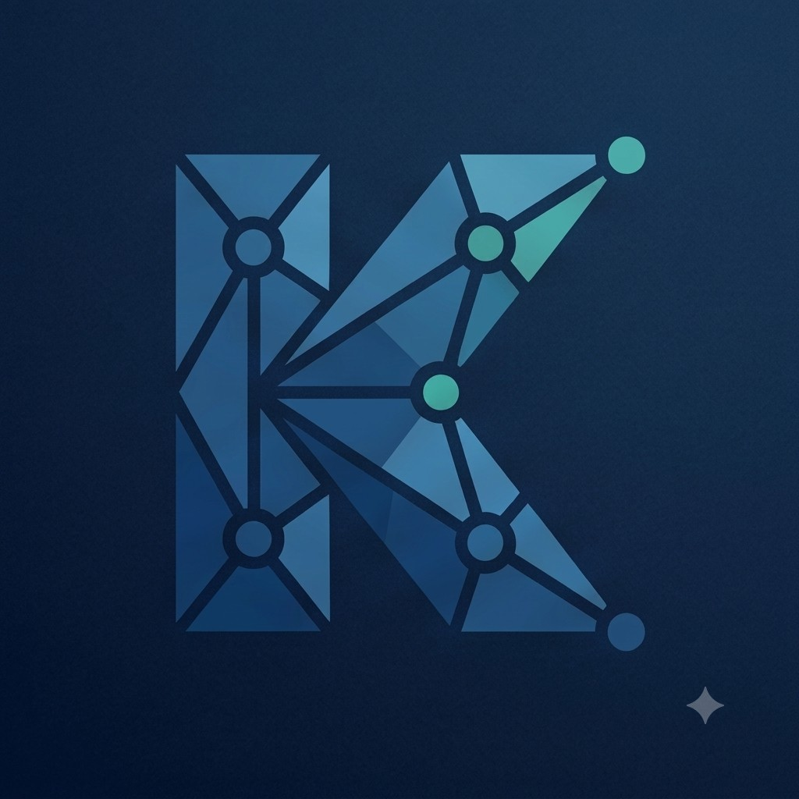

<div align="center">
  

  **KQL Assistant**

  Editing support for **Kusto Query Language (KQL)** on **Azure Monitor**, **Log Analytics**, **Microsoft Sentinel**, and related platforms.

  *Offline validation · Detection lint · Schema packs · Analytics-rule export · IntelliSense*
</div>

---

## At a glance

KQL Assistant is a **language support** extension for `.kql` / `.kusto` / `.csl` files: highlighting, diagnostics, completions, hover text, formatting, query organization, and detection-engineering helpers. It ships a large **offline** table/column catalog (**721** tables, plus optional ASIM `_Im_*` parser stubs) so you get validation and suggestions without signing in to Azure.

**Validation is offline, not execution:** diagnostics use parser-backed query structure plus the bundled (or user-supplied) schema to catch many typos, scope mistakes, structural issues, and common cost anti-patterns. They do **not** prove a query will run in your workspace. Always run queries in Azure to confirm.

**Out of scope:** this extension **does not execute queries**. It does not connect to an Azure Data Explorer cluster or a Log Analytics workspace. Run queries in the Azure portal, Microsoft Sentinel, Fabric, or another tool that supports execution against your data plane.

## Features

**Editing and syntax**

- Syntax highlighting, bracket/quote behavior, comments, folding
- Real-time diagnostics (debounced while typing): brackets and strings, pipes, SQL-style patterns (`select` / `from`), table/column names against schema, multiline join / lookup keys, `let` bindings, `datatable` IOC lists, and query-block scope
- Optional **detection/cost lint** (`kqlAssistant.lintMode`): early time filters, prefer `has` over `contains`, bare `search`/`find`, join `kind=`, `mv-expand` limit, fuzzy union (rules KQL101–KQL107)

**IntelliSense and schemas**

- Completions for 721+ bundled tables, operators, chart types, and 100+ functions
- Column suggestions (with type and description) from the same query scope used by diagnostics
- **Schema packs** (`kqlAssistant.schemaPacks`): `all`, `sentinel-core`, `mde`, `identity`, `asim`, `asim-parsers`
- Optional **custom schema** via `kqlAssistant.userSchemaPath` for tenant-specific tables (merged over bundled data). Convert an Azure CLI table-list JSON with `kql-assistant schema convert` (see CI section).
- Hover documentation for operators and functions; hover on **table names**, **column names**, **`_GetWatchlist`**, and MITRE `TA####` / `T####` IDs
- Signature help while typing function arguments
- Completions, hover, signature help, and quick fixes inside Sentinel YAML `query: |` blocks, using the same query scope as a `.kql` file. Suggestions apply inside the query block and appear alongside the YAML extension

**Detection engineering**

- Organize hunts with `# Category #` / `## Rule ##` headers (folding, Outline, CodeLens)
- Rule metadata comments (`// tactic:`, `// technique:`, `// severity:`, …) shown on CodeLens and in Outline
- **KQL: Export Analytics Rule YAML** — Sentinel scheduled-rule YAML from the current rule block (infers connectors and entity mappings)
- **KQL: Import Analytics Rule YAML** — Sentinel `query: |` YAML back into a `## Rule ##` KQL document
- Security-oriented snippets (MDE, ASIM, watchlist, TI, syslog, sign-in / SecurityEvent patterns)
- Headless **CLI** for CI: `kql-assistant lint` with globs, SARIF, `kql-assistant.json`, and `--ignore-pattern`

**Productivity**

- **Go to Definition / Find All References / Rename** on `let` bindings
- Format Document and Format Selection
- Code actions (lightbulb): typos, SQL-style fixes, brackets, missing `|`, ignore unknown tables
- Inline CodeLens on headers (copy / select / export, metadata summary, line counts)

## Installation

### VS Code Marketplace (recommended)

1. Open the Extensions view (`Ctrl+Shift+X` / `Cmd+Shift+X`)
2. Search for **KQL Assistant**
3. Install

Or open the [Marketplace listing](https://marketplace.visualstudio.com/items?itemName=petstuk.kql-assistant).

### From source or VSIX

```bash
git clone https://github.com/petstuk/kql-assistant.git
cd kql-assistant
npm install
npm run compile
```

- **Development:** press `F5` in VS Code (Extension Development Host)
- **VSIX:** `npm run package` then  
  `code --install-extension kql-assistant-0.10.1.vsix`

## Quick start

1. Open or create a file with extension `.kql`, `.kusto`, or `.csl`
2. Start from a table name, then chain operators with `|`
3. Use **Format Document** (`Shift+Alt+F`) and **KQL: Check Syntax** when you want a full offline validation pass (does not run against Azure)

## Organizing detection rules

Use markdown-style headers so folds, outline, and CodeLens stay aligned:

- `# Category Name #` — group
- `## Rule or query name ##` — one query block
- Optional metadata comments immediately under the rule header

Example:

```kql
# Identity #

## Suspicious sign-ins ##
// tactic: TA0006
// technique: T1110
// severity: Medium
// description: Failed Entra sign-in burst
// queryFrequency: 1h

SigninLogs
| where TimeGenerated > ago(1h)
| where ResultType != 0
| project TimeGenerated, UserPrincipalName, IPAddress
```

Fold arrows in the gutter collapse sections; use the **Outline** view to jump between blocks. Use **Export Rule** on the CodeLens (or **KQL: Export Analytics Rule YAML**) to open a Sentinel analytics-rule YAML stub.

## Commands

| Command | Action |
|--------|--------|
| **KQL: Check Syntax** | Re-run offline diagnostics; message clarifies this is not execution validation |
| **KQL: Select Current Query** | Select the query section around the cursor (respects header boundaries) |
| **KQL: Copy Current Query** | Copy query body to the clipboard (without the header line / metadata comments) |
| **KQL: Export Analytics Rule YAML** | Open a Sentinel scheduled analytics-rule YAML for the current `## Rule ##` |
| **KQL: Import Analytics Rule YAML** | Open a `## Rule ##` KQL document from Sentinel YAML with `query: |` |

Open via **Command Palette** (`Ctrl+Shift+P` / `Cmd+Shift+P`), the editor context menu, or:

- `Ctrl+Alt+Shift+K` / `Cmd+Alt+Shift+K` — Check Syntax
- `Ctrl+Alt+Shift+C` / `Cmd+Alt+Shift+C` — Copy Current Query
- `Ctrl+Alt+Shift+E` / `Cmd+Alt+Shift+E` — Export Analytics Rule YAML

## Configuration

| Setting | Default | Description |
|--------|---------|-------------|
| `kqlAssistant.enableDiagnostics` | `true` | Turn syntax/schema diagnostics on or off |
| `kqlAssistant.diagnosticLevel` | `error` | Severity for syntax/schema issues: `error`, `warning`, or `information` |
| `kqlAssistant.userSchemaPath` | *(empty)* | Optional JSON file with custom tables/columns (same shape as bundled `schemas/all-tables.json`); merged over bundled schemas |
| `kqlAssistant.ignoredTables` | `[]` | Table names to skip for unknown-table diagnostics (also set via lightbulb **Ignore unknown table**) |
| `kqlAssistant.lintMode` | `basic` | Detection/cost lint: `off`, `basic`, or `strict` (rules KQL101–KQL107) |
| `kqlAssistant.schemaPacks` | `["all"]` | Schema packs to load (`all`, `sentinel-core`, `mde`, `identity`, `asim`, `asim-parsers`) |

In Settings, search for **KQL Assistant**.

### CI / headless lint

After `npm run compile`:

```bash
npm run lint:kql -- detections/**/*.kql --lint basic
node out/src/cli.js lint detections/**/*.{kql,yaml} --format sarif --fail-on warning --ignore-pattern '**/generated/**'
```

Copy [`examples/github-kql-lint.yml`](examples/github-kql-lint.yml) into `.github/workflows/` to upload SARIF on PRs.

Repo baseline (`kql-assistant.json` in the workspace root, example at [`examples/kql-assistant.json`](examples/kql-assistant.json)):

```json
{
  "lint": "basic",
  "ignorePatterns": ["**/generated/**"],
  "severity": { "KQL101": "off" }
}
```

Inline suppressions: `// kql-disable-next-line KQL103`, `// kql-disable-line`, `// kql-disable` / `// kql-enable`.

| Code | Meaning |
|------|---------|
| KQL001–015 | Syntax / schema (pipes, SQL keywords, unknown table **KQL013**, unknown column **KQL014**, join key **KQL015**, …) |
| KQL101 | No early time filter |
| KQL102 | Join without `kind=` |
| KQL103 | Prefer `has` over `contains` |
| KQL104 | Bare `search` / `find` |
| KQL105 | Project after join/union (strict) |
| KQL106 | `mv-expand` without `limit=` (strict) |
| KQL107 | `union isfuzzy=true` (strict) |

### Export a workspace schema (offline)

The extension never signs in to Azure. Export tables yourself, then convert:

```bash
az monitor log-analytics workspace table list \
  --resource-group <rg> \
  --workspace-name <workspace> \
  --output json > tables.json

node out/src/cli.js schema convert tables.json -o workspace-tables.json
```

Or export `| getschema` JSON for one table and pass `--table TableName`. Point `kqlAssistant.userSchemaPath` (or `"userSchemaPath"` in `kql-assistant.json`) at the converted file.

## Snippets

There are **41** snippets: type a prefix (e.g. `timerange`, `rulemeta`, `getwatchlist`, `mdeprocess`) and press **Tab**. The full set is defined in [`snippets/kql.json`](snippets/kql.json).

Security-oriented prefixes include: `failedlogins`, `suspiciouslogin`, `signinanalysis`, `securityalerts`, `emailsecurity`, `mdeprocess`, `mdenetwork`, `asimnet`, `watchlistjoin`, `timatch`, `syslogauth`, `hasfilter`.

## Editor tips

- **Hover** operators, functions, tables, and columns (when context is known) for documentation
- **Lightbulb** fixes appear on diagnostics from KQL Assistant
- **Format Document** normalizes pipes, spacing, and commas (see also Format Selection for a range)
- Prefer `has` / `has_any` over `contains` on large tables — the lint pack will hint when `lintMode` is enabled

## Example queries

```kql
SigninLogs
| where TimeGenerated > ago(24h)
| where ResultType != 0
| summarize FailedAttempts = count() by UserPrincipalName, IPAddress
| where FailedAttempts > 3
| order by FailedAttempts desc

DeviceProcessEvents
| where TimeGenerated > ago(1d)
| where FileName has "powershell.exe"
| project TimeGenerated, DeviceName, AccountName, ProcessCommandLine, SHA256
| take 100
```

## Supported language surface (summary)

KQL is large; the extension focuses on common **keywords**, **tabular operators**, **aggregation** helpers (`count`, `sum`, `dcount`, `make_list`, …), and **scalar** functions (`ago`, `bin`, `parse_json`, `tostring`, …). Completions and hovers cover a substantial subset; see [KQL reference](https://learn.microsoft.com/en-us/kusto/query/) for the full language.

## Known limitations

- Validation is **offline parser-backed structure + schema + lint heuristics** — not the Kusto compiler; a clean file does not guarantee the query runs in your environment
- Join / lookup validation covers common single-line and multiline `on` keys; complex join shapes are still partial
- Heavy use of subqueries, `dynamic`, or macros may produce imperfect diagnostics
- Function parameter **types** are not deeply validated
- Schemas are not fetched from Azure automatically; convert a local JSON export with `kql-assistant schema convert` and set `kqlAssistant.userSchemaPath`
- Analytics-rule YAML export infers connectors and entity mappings — still review thresholds before deploy

## Contributing

Issues and pull requests are welcome. See [CONTRIBUTING.md](CONTRIBUTING.md) for bug reports, feature ideas, and development setup.

## License

MIT — see [LICENSE](LICENSE).

## Acknowledgments

Built using Microsoft’s [KQL documentation](https://learn.microsoft.com/en-us/kusto/query/) and community practice for Log Analytics and Sentinel queries.

## Release notes (recent)

### 0.10.1

- Hunt-notebook column scope: `let` scalars, dotted JSON paths, `union withsource=`, `has_any`, and `render` no longer false-positive
- CLI globs, `kql-assistant.json`, `--ignore-pattern`, and `schema convert`
- Go to Definition / references / rename for `let`; MITRE and `_GetWatchlist` hover
- Import Sentinel analytics-rule YAML; KQL106/KQL107 in strict lint

### 0.10.0

- Detection/cost lint pack (KQL101–105) and headless `kql-assistant lint` CLI (text/SARIF)
- Schema packs + `SecurityAlert` / `Syslog` + ASIM `_Im_*` parser stubs
- Export Sentinel analytics-rule YAML from `## Rule ##`; MITRE/severity metadata in CodeLens/Outline
- Join-shaped `lookup` validation; `datatable` IOC `let` scope; expanded security snippets

### 0.9.1

- New Marketplace icon; **Ignore unknown table** persistence; missing-pipe diagnostics; join-kind completions; `lookup` hover; activate only for KQL files; cleaner VSIX packaging.

### 0.9.0

- **Parser-backed query understanding**: diagnostics, completions, and hovers now share a QueryModel for query blocks, pipe steps, aliases, `let` table bindings, multiline join keys, `project-away`, and simple `mv-expand`.

### 0.8.3

- **Trust & scope**: Check Syntax and post-save feedback aligned with what the extension actually validates; optional `userSchemaPath` for custom tables; information diagnostics when column checks are limited; single-line join key validation; debounced live diagnostics; unit tests and CI.

Earlier versions: [CHANGELOG.md](CHANGELOG.md).
